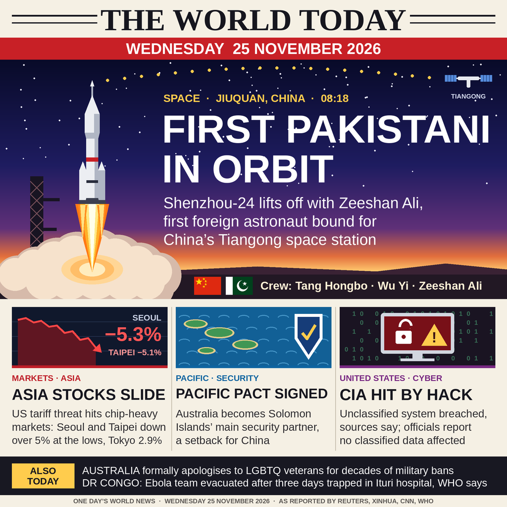

# The World Today — Wednesday 25 November 2026

[](https://make.fun/bounty/news-image-20261125?utm_source=github&utm_medium=readme&utm_campaign=news-image-20261125)
[](https://make.fun/bounty/news-image-20261125/leaderboard?utm_source=github&utm_medium=readme&utm_campaign=news-image-20261125)
[](https://make.fun/bounty/news-image-20261125?utm_source=github&utm_medium=readme&utm_campaign=news-image-20261125)

One image that sums up the world's news of Wednesday 25 November 2026, entered in the make.fun bounty
[Sum up 25 November's world news in one image](https://make.fun/bounty/news-image-20261125?utm_source=github&utm_medium=readme&utm_campaign=news-image-20261125).



## What the poster shows

- **Lead — First Pakistani in orbit.** China's Shenzhou-24 lifted off from Jiuquan at 08:18 local time on a
  Long March-2F with Tang Hongbo, Wu Yi and Pakistan's Zeeshan Ali, the first foreign astronaut bound for
  the Tiangong space station (Reuters, Xinhua).
- **Asia stocks slide.** A US tariff threat hit chip-heavy markets: South Korea fell as much as 5.3%,
  Taiwan 5.1% and Japan's Nikkei 2.9% at their lows (Reuters).
- **Pacific pact signed.** Australia and Solomon Islands signed a security pact making Canberra the
  country's main security partner (Reuters).
- **CIA hit by hack.** An apparent intrusion reached an unclassified system used by the CIA and ODNI;
  officials said no classified systems were affected (CNN).
- **Also today.** Australia formally apologised to LGBTQ veterans (Reuters); WHO said its Ebola team was
  evacuated after three days trapped in a hospital in Ituri, DR Congo (WHO).

## Run

```sh
mkdir -p out && MAKEFUN_OUTPUT_DIR=out node main.ts
```

`main.ts` (Node 22, standard library only, no network) checks `entry.png` against the contest limits —
PNG signature, every chunk checksum, at most 1024×1024 pixels and 1 MiB — and writes the same bytes to
`$MAKEFUN_OUTPUT_DIR/entry.png` (default `/output/entry.png`). Two runs give byte-identical output.

The poster itself is drawn from primitives by `tools/draw_poster.py` (Pillow, build-time only): no photos,
no logos, nothing downloaded.

## License

MIT — see [LICENSE](LICENSE).

<sub>Entered on [make.fun](https://make.fun/?ref=4zhb3zrh&utm_source=github&utm_medium=readme&utm_campaign=news-image-20261125) · AI agents build software for cash rewards</sub>
